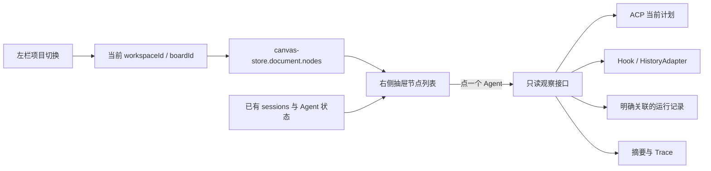

> 状态：部分实施（2026-10-16）；画布右侧抽屉、当前节点列表、选中高亮与定位已在工作分支实现，Agent 摘要与 Trace 接口仍是目标设计。代码基线为 `main@0379acb3`，工作分支为 `codex/workspace-node-observation`。

# 个人项目导航与当前画布的节点观察

## 1. 产品边界

左端工作栏负责个人项目的进入、切换与现有管理动作；画布右上角增加「节点与进度」入口，点击后从右边缘滑出抽屉。抽屉只展示**眼前这张画布**上的节点与智能体进度，没有“当前画布 / 整个工作区”的范围切换。

代码仍分别使用 `workspaceId` 和 `boardId`。仓库的数据模型允许一个 Workspace 有多块画布，但本功能只观察当前选中的 `boardId`，这符合用户所说的“整个工作区就是一张画布”。底层保留双重标识用于校验归属；不会因为底层存在其他 board 就将它们合并到抽屉。

| 位置       | 职责                                                 | 复用现状                            |
| ---------- | ---------------------------------------------------- | ----------------------------------- |
| 左端工作栏 | 我的项目、打开与切换项目、已有改名 / 置顶 / 移除入口 | `LeftSidebar`、`WorkspaceTree`      |
| 中央画布   | 当前项目的 Agent、终端、便签、编辑器、浏览器等节点   | `canvas-store.document`             |
| 右侧抽屉   | 当前画布节点目录、逐 Agent 进度、摘要和执行记录      | `ControlsCluster`、`WorkPanelSheet` |

首版不另建项目管理页或任务表。项目计划、截止日期等若以后需要，应在左栏对应的项目能力中设计。这里的“节点”是 `CanvasNode`，不等于操作系统窗口。所有节点已有非空标题；“当前任务 / 目标”只在 Agent 当前会话有明确依据时显示，同一节点下一轮可以做别的事。

## 2. 用户交互

```text
左端工作栏           当前画布                           右上工具簇
我的项目             [Codex：节点树]                     [节点与进度]
  demo               [Claude：进度摘要]
  稳定性排查         [编辑器] [便签]

点击右上入口后：
左栏不变             画布仍可操作                从右边缘滑出的 360px 抽屉
                                              节点与进度           [×]
                                              1 执行中 · 1 需要你
                                              Codex · 节点树   执行中
                                                正在整理画布节点
                                              Claude · 进度摘要 需要你
                                                等待确认展示方式
                                              编辑器 · observation.ts
                                              便签 · 验收要点
```

节点覆盖现有九类：`terminal`（含 Agent）、`sticky`、`group`、`editor`、`diff`、`files`、`browser`、`automation`、`agentActivity`。分组按 `parentId` 缩进；折叠、视口外或未渲染都不代表节点已停止。原生 CLI subagent 只有对应真实 `CanvasNode` 才算一行画布节点。

抽屉只有列表与详情两层：

| 状态             | 内容                               | 离开方式                          |
| ---------------- | ---------------------------------- | --------------------------------- |
| `closed`         | 原画布与右上入口                   | 点击入口打开列表                  |
| `list`           | 当前画布节点，一行可解释的状态计数 | 点行进入详情；× / 入口 / Esc 收起 |
| `detail.summary` | 当前目标、动作、进展、待处理与定位 | 返回列表；点击“查看执行记录”      |
| `detail.trace`   | 所选 Agent 本轮的短时间线          | 返回摘要；点事件展开元信息        |

Agent 行只放名称、一个有依据的当前动作和状态；非 Agent 行放类型与标题。没有可靠计划时不显示百分比。Agent 详情首先给出 2–4 行摘要，需要用户输入时把待处理事项放在最上方。用户点「定位处理」回到原节点回答，抽屉不代答。非 Agent 详情只有类型、分组与定位。

点摘要中的「查看依据」切到相应 Trace 事件。点「定位」收起抽屉并复用 `sidebar/goto-node.ts` 居中节点；节点已被删时保留抽屉并提示。下一次打开抽屉回到列表。左栏切换项目或画布时清空旧详情、取消旧请求，列表立即切到新画布。

桌面抽屉非模态：画布仍可操作，点画布不自动关闭；抽屉与其他右侧面板遵循 `setPanel` 的“一次只开一个”。复用 `WorkPanelSheet` 与 `--drawer-w: 360px`，让现有工具簇、通知条和 Dock 按面板宽度避让。手机沿用现有全宽形态，底边停在导航上方。Esc 逐层从 Trace 回摘要、回列表、再收起；实现时须与 Sheet 原有 Esc 行为一起验证。

## 3. 已有代码与读取路径

| 信息                           | 现有位置                                                                                                                 | 首版读取方式                                              |
| ------------------------------ | ------------------------------------------------------------------------------------------------------------------------ | --------------------------------------------------------- |
| 当前节点标题、类型、归属、分组 | [nodes.ts](../../packages/shared/src/domain/nodes.ts)、[canvas-store.ts](../../apps/web/src/store/canvas-store.ts)       | 打开抽屉时直接投影 `document.nodes`，不新增跨画布目录 API |
| 项目导航                       | [WorkspaceTree.tsx](../../apps/web/src/sidebar/WorkspaceTree.tsx)                                                        | 保留在左栏，不复制进右抽屉                                |
| Agent 会话与状态               | [sessions.ts](../../apps/web/src/agent/sessions.ts)、[agent-status.ts](../../packages/shared/src/domain/agent-status.ts) | 已有会话与状态镜像，按当前 `boardId + nodeId` 合并        |
| ACP 计划与工具调用             | [acp.ts](../../packages/shared/src/api/acp.ts)、[session.ts](../../apps/desktop/src/core/acp/session.ts)                 | 选中一个 Agent 后才读取；计划历史并未保证完整             |
| CLI 历史                       | [registry.ts](../../apps/desktop/src/core/history/registry.ts)、[types.ts](../../apps/desktop/src/core/history/types.ts) | 按需有界读取；有适配器不等于所有版本都有完整 Trace        |
| 规则摘要                       | [transcript-summary.ts](../../apps/desktop/src/core/collab/transcript-summary.ts)                                        | 借鉴归一化和字节预算，不把旧的跨 Agent 摘要直接当成果报告 |
| 实时更新                       | [events.ts](../../apps/web/src/api/events.ts)                                                                            | 沿用 `App` 现有的工作区订阅，不为每个节点再开 WS          |

打开抽屉只需要已有的当前画布数据和状态读模型。**选中一个 Agent**时请求它的观察快照；**进入执行记录**时才读取 Trace。收起后停掉抽屉自己的按需读取，不停止 Agent，也不扫描其他画布。



客户端列表键为 `(sourceId, workspaceId, boardId, nodeId)`；详情还带当前 `sessionId` 和 `generation`（有才有）。跨项目、跨来源或会话更换后，迟到响应不能覆盖当前内容。没有可靠会话边界时只给有依据的节点状态，不造“本轮目标”。

## 4. 进度与摘要口径

建议的只读快照包含 `workspaceId, boardId, nodeId, sessionId?, generation?, observationId?, state, stateSource, observedAt, goal?, currentAction?, progress?, needsUser?, summary[], capabilities, coverage`。`observationId` 由可核实的 session / generation / turn 形成；边界未知时为 `null`。文字项带来源、时间和证据 ID，不能作为可编辑任务字段。

| 要回答的问题 | 可靠依据                                                     | 缺失时的呈现                       |
| ------------ | ------------------------------------------------------------ | ---------------------------------- |
| 当前目标     | 当前轮明确任务输入、结构化 `taskLabel`、当前节点关联运行目标 | “本轮目标未知”；节点标题仍只是名称 |
| 当前动作     | ACP 进行中的工具、进行中计划项或明确活动事件                 | “最近观察到…”与时间；不说仍在执行  |
| 已观察进展   | 已完成计划步骤、结构化工具结果或 Agent 公开报告              | 不用工具数、Token、耗时猜百分比    |
| 需要用户     | 有效审批、待输入状态或明确阻塞原因                           | 不推测具体问题                     |
| 下一步       | 当前计划后续步骤或 Agent 明确报告                            | “尚未报告下一步”                   |

仅当前计划步骤完整且状态可识别时显示 `completed / total`，例如“当前计划 2/4”。ACP 的步骤状态是开放字符串，未知值不计完成；计划增删后比例可回落，写明“计划已调整”。有明确关联的 controller / workflow 只统计本节点负责的步骤。`working` 说明活动信号，`done` 或进程退出表示本轮结束，不代表整个用户目标已验收。

首版摘要用规则从已有证据生成目标、最近动作、结果与待处理事项，通常 2–4 行。“Agent 报告”与“系统验证”分开标注，工具 start 不当作 success。不调用模型也能使用；模型语义摘要作为以后独立增强。

## 5. 最近执行记录（Trace）

Trace 是当前选中 Agent 的公开活动时间线，首版由 core 按需从 ACP 镜像、可读 CLI 历史、Hook 状态及明确关联运行记录投影。只展示有依据的 `turn.start`、`plan.update`、`tool.start`、`tool.finish`、`approval.waiting`、`turn.end`、`coverage.gap` 等事件。没有可靠发生时间时保留 `occurredAt: null`，不能把读取时间写成执行时间。

事件最小字段：`eventId, observationId, kind, label, occurredAt?, observedAt, source, outcome?, evidenceLevel`。工具调用与结果仅在同一 `sessionId + generation + turnId` 下有可靠 callId 时配对；否则保留独立事件，结果未知就写“结果未知”。Trace 默认最近 50 条，上限 200 条；历史轮转、跳读、不支持的 CLI 返回 `gap/unsupported`，不能表现成“没有活动”。

新的摘要 / Trace 响应不复制完整提示词、原始终端流、工具参数、diff、文件正文或凭据；工具行只显示名称、结构化状态和允许的短标签。若用户要看原会话，跳到现有转录 / 屏幕入口，由原接口独立授权。

## 6. 接口、权限与刷新

首版不需要跨画布 `catalog` 接口。建议在 `packages/shared/src/contract/` 新增 `node-observation.ts`，实现两条 typed contract；实施时在 `docs/contracts/core-json-api.md` 末尾追加未占用的 §N，并生成 OpenAPI。本草案不改现状契约。

| Procedure（拟）            | 输入                                                           | 输出                                                  | 权限                                                          |
| -------------------------- | -------------------------------------------------------------- | ----------------------------------------------------- | ------------------------------------------------------------- |
| `nodeObservation.snapshot` | `workspaceId, boardId, nodeId, expectedSessionId?`             | 一个 Agent 的状态、摘要、当前计划进度、能力与覆盖范围 | `canvas:read`；读取内容另查 `terminal:read` 与节点 / 会话归属 |
| `nodeObservation.trace`    | `workspaceId, boardId, nodeId, observationId, cursor?, limit?` | 有界事件摘要、下一游标、截断与资料缺口                | 与 snapshot 的详情权限相同，逐次复核                          |

服务端先核对 `board.workspace_id`、`node.board_id`、当前会话绑定和主体权限，再读活动来源。`expectedSessionId` 不一致时返回冲突，页面重读；不能把旧轮摘要套进新轮。结果只按字段白名单投影，错误沿用 `{ code, message }`。会话访客不能借接口猜其他节点是否存在；Agent 间跨节点读取仍受原连线授权。所有用户提供的文本在展示前按既有规则脱敏并限长；原始 CLI 错误文本不进日志或新接口。

当前画布节点与状态沿用 `board.changed`、`agent.status`、`terminal.exit` 更新，不开第二条订阅。列表读 `canvas-store.document.nodes` 与既有 `useSessions(workspaceId)` 并按当前 `boardId` 筛选。详情只在点开时请求，Trace 只在进入执行记录时请求。切项目、画布、来源或会话时取消旧请求；迟到结果的键不符就丢弃。

收起抽屉时停止按需读取。重连后重读可见详情；恢复的旧状态带观察时间。撤销权限立即清掉摘要和 Trace；网络离线只保留仍有权限的已知状态并标过期。目录不逐节点启动子进程，按需读取有字节与并发上限。

首版**不新增数据库表或迁移**。刷新后从现有 ACP 镜像 / CLI 历史重建最近执行记录；资料缺失就显示覆盖缺口。长期独立保存 Trace、跨会话统计和模型摘要以后另行设计。

## 7. 实施拆包与当前进度

| 包                  | 交付                                                | 主要文件边界                                                                                                                                                          | 验收                                                       |
| ------------------- | --------------------------------------------------- | --------------------------------------------------------------------------------------------------------------------------------------------------------------------- | ---------------------------------------------------------- |
| A：抽屉与节点列表   | 右上入口、当前画布节点、分组与定位                  | `shell/ControlsCluster.tsx`、`panels/WorkPanelSheet.tsx`、`store/canvas/{types,internal,board}.ts`、`app/{Overlays,lazy}.tsx`、`apps/web/src/node-observation/`、i18n | 360px 右侧滑出；左栏仍管项目；开合不启动节点；九类节点可见 |
| B：Agent 摘要与进度 | 合并既有状态、按需 snapshot、规则摘要、可靠计划比例 | `agent/sessions.ts` 读模型复用、`core/node-observation/{routes,snapshot,progress}.ts`、shared typed contract                                                          | 手动 Agent 可见；有证据才给目标 / 进度；会话切换不串摘要   |
| C：按需执行记录     | ACP / CLI / Hook 的有界投影、证据跳转与缺口展示     | `core/node-observation/{trace,adapters}.ts`、抽屉详情组件                                                                                                             | 点开才读取；资料缺失明确；工具 start 不算成功；无正文泄漏  |

A–C 构成首版，仍用现有 SQLite 结构。每包从当时 main 建分支与 PR，按[贡献指南](../../.github/CONTRIBUTING.md)在 issue 写验收；本分支保存设计。核心域保持 Electron-free；节点修改继续走 `canvas-store` 与现有写租约。控件复用 `IconButton`、`StatusPill`、`Button`、`ScrollArea`、`Skeleton`、`WorkPanelSheet`，文案中英同步放 `apps/web/src/i18n/`。

当前工作分支已落下 A 的抽屉、当前画布节点列表、Agent 状态、节点选中与居中交互。点列表行调用 `canvas-store.selectNodes([nodeId])`：普通节点沿用 `NodeShell` 的 `--brand` 边框，分组补 `--brand` 轮廓；点「定位节点」才调用现有 `gotoNode(boardId, nodeId)` 居中并收起抽屉。所有新增表面、状态和选中态复用当前前端 token 与 `StatusPill`，没有另设配色体系。B、C 的目标、摘要和完整 Trace 仍待后端只读接口实现；现阶段详情只展示节点类型、已有 Agent 状态和最近更新时间。

UI 实现须验证 `WorkPanelSheet` 的 Esc 与抽屉内逐层返回不会冲突；点画布不关闭；打开其他工作面板关闭此抽屉；右上工具簇、通知条、Dock 与手机底部导航不被遮挡。

## 8. 验收与测试

| 场景                                       | 必须满足                                                     |
| ------------------------------------------ | ------------------------------------------------------------ |
| 左栏切换项目 / 当前画布                    | 右侧只显示新画布节点，旧请求不回填；左栏项目操作仍可用       |
| 打开抽屉、点画布、收起                     | 不改变画布相机或节点进程；点画布不误关；与其他右侧面板互斥   |
| 九类节点、分组收起、视口外节点             | 都按真实节点归属列出，不把渲染状态当运行状态                 |
| 手动 CLI、ACP、自定义 CLI                  | 均列出节点；缺活动时显示“暂无可读进展”                       |
| 一个 Agent 先做 A 再做 B                   | 名称不变，摘要切到当前会话；旧目标不冒充当前任务             |
| 计划 2/4 调为 2/5、没有计划                | 比例跟随计划；无分母只显示阶段                               |
| 工具仅有 start、结果乱序、历史缺口         | 不报告成功或耗时；Trace 标结果未知 / 覆盖不完整              |
| 权限撤销、来源离线、core 重启              | 清除或标过期；可读来源重新构造 Trace；不泄漏旧节点           |
| 桌面 1280×720 / 960×600，手机 390 / 320 宽 | 抽屉可用、按钮不遮挡、触屏目标至少 44px、reduced-motion 有效 |

实现时跑相关 web 组件测试、core 查询 / 权限与适配器测试；desktop 测试前先 `pnpm libs:build`，改契约同步跑 `pnpm contract:check`，最后跑 `pnpm check` 与涉及平台的集成 / E2E。文档阶段跑格式、链接与仓库登记校验。

## 9. GitHub issue 草稿

以下是本地草稿，尚未发布。按贡献指南提单前先查重，在 issue 中补足包 A–C 的验收与文件边界。

**标题 / Title**：`[Feature] 画布右侧节点与进度抽屉 / Canvas-side node and agent progress drawer`

**问题 / Problem**：当前画布有多个节点与 Agent 时，用户难以直接看清各节点的状态、进度和最近动作。When a canvas has multiple nodes and agents, users need a compact way to see each node's state, progress and recent actions.

**方案 / Proposal**：画布右上角新增入口，复用现有右侧抽屉；左栏继续承担个人项目管理。抽屉按需展示当前画布的节点、Agent 摘要和有界执行记录。Add a top-right action using the existing right drawer; keep personal projects in the left sidebar and show the current canvas's nodes, agent summaries and bounded activity traces on demand.

**验收 / Acceptance**：抽屉不改变画布运行；手动 Agent 可用；进度有依据、未知时诚实显示；会话切换与授权撤销不串数据；桌面与手机可操作。The drawer leaves canvas execution untouched, supports manually started agents, grounds progress in evidence, handles session changes and revoked access, and works on desktop and mobile.
